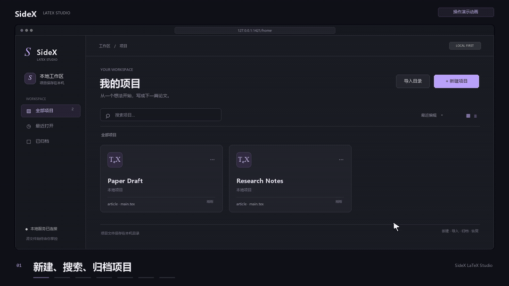

# SideX LaTeX Studio

[Watch the feature demo: 56 seconds, silent interface animation](docs/media/demo.mp4)

**A local LaTeX workspace with a project home, source-linked PDF editing, and a configurable AI agent.**

[简体中文](README.zh-CN.md) · [Project advantages](docs/PROJECT_ADVANTAGES.zh-CN.md) · [Third-party notices](docs/THIRD_PARTY_NOTICES.md)

SideX LaTeX Studio combines a focused Monaco editor, real TeX output, a terminal, and an optional agent in one browser workspace. Its local project home lets you create, import, find, rename, archive, and reopen papers without a cloud account.

This is a focused application derived from [Sidenai/Sidex](https://github.com/Sidenai/sidex), with live paragraph typesetting powered by [realtime-tex](https://github.com/HenryXiaoYang/realtime-tex). This repository contains the LaTeX application rather than the upstream desktop and extension platform.

## What you can do

| Area | Capabilities |
| --- | --- |
| Project home | Grid/list views, search and sorting, recent projects, blank/article templates, existing-folder import, display-name changes, archive and restore |
| Workbench | Side-by-side TeX and PDF, resizable panels, source-area toggle, document outline, file search, and a local terminal |
| PDF editing | Place a caret in mapped prose, edit a whole paragraph, select text, undo changes, and write the result back to TeX |
| Math and navigation | Edit the LaTeX expression near its rendered formula; synchronize mapped characters between source and page |
| Figures and tables | Eight resize handles, independent axes, whole-float moves, and preservation of captions and labels |
| Optional agent | Discover models from an OpenAI-compatible API, paste images, search project files, and make visible project-scoped edits |

Each project has its own file root, capability token, terminal, real-time engine, and agent task context. Opening another project does not redirect an existing editor's saves to the new folder. Model settings are shared across the local application.

## Start on Windows

Install **Node.js 22.11+ LTS or newer**. Install **TeX Live or MiKTeX** to compile documents. The project home can run before a TeX distribution is installed.

1. Download or clone the complete repository.
2. Double-click [Start-LaTeXStudio.cmd](scripts/launch/Start-LaTeXStudio.cmd), or the Chinese alias [一键启动.cmd](一键启动.cmd).
3. The launcher installs locked npm dependencies on first use, builds when necessary, starts the service hidden, and opens **http://127.0.0.1:1421/home**.
4. Create a project or import an existing local folder, then open it in the workbench.

The first dependency installation requires network access. The launcher does not install a large TeX distribution or modify global TeX settings. If the local service is already running, it reuses it and opens the home page.

Installation and build logs stream in the launcher with elapsed time. Network retries and stage waits are bounded. If npm downloads return 502 or connection errors, check your network, proxy, or npm configuration and inspect `.runtime/npm.stdout.log` and `.runtime/npm.stderr.log`. Successful installs are reused on later starts.

Manual startup:

~~~sh
npm ci
npm run build
npm start
~~~

For development:

~~~sh
npm run dev
~~~

## Start on Linux or macOS

Install **Node.js 22.11+ with npm**. To compile documents, install **TeX Live** on Linux or **MacTeX / BasicTeX** on macOS. The project home works before TeX is installed.

- **macOS:** double-click [Start-LaTeXStudio.command](Start-LaTeXStudio.command) in Finder.
- **Linux:** run [Start-LaTeXStudio.sh](Start-LaTeXStudio.sh), or choose “Run as a program” if your file manager supports it.

~~~sh
./Start-LaTeXStudio.sh
~~~

The launcher supports paths containing spaces and invocation from any directory. It installs locked dependencies on first use, builds when needed, starts a detached local service, and opens **http://127.0.0.1:1421/home**. Subsequent launches reuse the service. Native dependencies are reinstalled when the OS, CPU architecture, Node ABI, or lockfile changes. TeX and optional realtime-tex binaries are not installed automatically.

If an extracted ZIP loses executable permissions, run `chmod +x Start-LaTeXStudio.sh Start-LaTeXStudio.command`, or use `sh Start-LaTeXStudio.sh`. For downloaded scripts, use Finder's normal Open action if macOS prompts you.

For a server without a graphical desktop, or to choose another port:

~~~sh
./Start-LaTeXStudio.sh --no-browser
SIDEX_PORT=1422 ./Start-LaTeXStudio.sh --no-browser
~~~

The service listens only on `127.0.0.1`. For remote access, forward the port over SSH and open the local forwarded URL. Closing the launcher terminal leaves the service running. To stop it, run `kill "$(cat latex-service.pid)"` from this checkout. Installation/build logs are in `.runtime/npm.stdout.log` and `.runtime/npm.stderr.log`; service logs are `latex-service.stdout.log` and `latex-service.stderr.log`.

Normal compilation uses your installed TeX engines. The automated `npm run setup:rtex` helper and embedded real-time host currently target Windows x64. On Linux/macOS, install a matching upstream [realtime-tex CLI](https://github.com/HenryXiaoYang/realtime-tex/releases) separately and set `SIDEX_RTEX_PATH` to its executable for the optional live engine. Cross-platform startup does not mean every native live-editing feature has been validated on each OS.

Run `npm run test:launcher` for isolated launcher integration tests. CI checks Windows, Linux, and macOS and starts the actual application on POSIX runners.

## Enable live paragraph typesetting

Normal compilation supports the available pdfLaTeX, XeLaTeX, and LuaLaTeX engines. The optional real-time integration uses LuaLaTeX and a pinned realtime-tex 0.0.6 runtime.

The native session resolves files relative to the selected main document, while the editor and agent retain the full project scope. On Windows, an isolated compatibility runner handles legacy pdfTeX page dimensions and legacy Times font defaults without editing the manuscript. At startup, explicit dependencies outside the main document directory fall back to normal compilation. The runner uses the Windows .NET Framework 4 compiler; if it is unavailable, normal compilation remains available.

For the tested Windows x64 path, install Python 3.9+ and TeX Live with LuaLaTeX, then run:

~~~sh
npm run setup:rtex
~~~

The setup helper downloads the official runtime and verifies its published SHA-256. Native binaries are not included in this repository. The embedded Windows host checks ABI version 0.0.6; an unavailable optional host falls back to the official CLI.

TeX is discovered from explicit environment variables, an ignored local configuration, a managed installation, PATH, or standard installation locations. To select a custom installation, set SIDEX_TEXLIVE_BIN or SIDEX_TEX_BIN, or create .runtime/tex-config.json:

~~~json
{
  "bin": "C:/texlive/2026/bin/windows"
}
~~~

Only use the directory that exists on your machine. Restart the service after changing toolchain configuration.

## Projects and local data

- Newly created projects are stored in **.local/projects** by default. The catalog is **.local/projects.json**.
- Imported folders are registered in place. Importing does not copy or move their files.
- Renaming changes the display name. Archiving removes a project from the active list and does not delete its folder.
- **.local contains manuscript data, not disposable build caches.** Back up your projects before moving or removing a checkout.
- Use SIDEX_PROJECTS_DIR and SIDEX_PROJECTS_STATE to select an external managed-project folder and catalog file.
- Build output, runtime downloads, settings, logs, and agent edit backups live in ignored local locations. They are not part of the public source tree.

Return to the home page with the workbench's home button. It saves pending changes before navigating. The selected main document is remembered per project; other standalone TeX files can be selected as the main document.

## Configure an AI model

Open model settings and enter an API base URL and key. The application queries the provider's model catalog so you can choose a model without typing its ID. The selected model must support chat; image attachments require a model that accepts images.

Typed API keys stay in process memory and must be entered again after restarting the service. Non-secret model settings and the catalog are stored locally. The public version does not read credentials from another application's configuration files.

The agent is optional. When used, your messages, chosen context, images, and tool results are sent to the API endpoint you configure. Project tools can read and modify files within the selected project, show their execution trace and differences, and keep local edit backups.

## Editing and layout boundaries

Live editing re-typesets an affected paragraph and draws exact TeX glyph data. Full background passes handle pagination, references, and floating material. Unsafe or approximate overlays keep the last valid PDF until authoritative layout arrives; unfinished syntax does not require discarding the current input.

Formula editing currently exposes the LaTeX expression, rather than a visual math-symbol editor. Figure/table moves remain subject to the template's float rules. Complex macros, page-dependent material, and unsupported templates may require source editing or normal full compilation. LuaLaTeX and pdfLaTeX can produce different layout; use the engine required by your venue for final output.

## Performance and verification

The implementation reduces avoidable waiting through immediate idle-input dispatch, coalesced document updates, a latest-snapshot worker queue, batched UTF-8 mapping, and cached safety geometry. Explicit full-layout requests bypass an extra debounce, while automatic background work remains coalesced.

The [advantages report](docs/PROJECT_ADVANTAGES.zh-CN.md) separates engine timing, controller dispatch, and full-PDF readiness. These measurements do not include browser painting and are not a universal latency promise. Full-document compilation is not advertised as a 1 ms operation.

~~~sh
npm test
npm run typecheck
npm run build
npm run test:session
npm run test:page-tools
npm run test:host
~~~

The session, page-tools, and host integrations require the optional native runtime and a compatible TeX installation. The default test suite skips environment-dependent native cases when their prerequisites are absent. Windows is the primary validated platform; support on other systems depends on the available TeX and terminal toolchains.

## License and origins

Released under the [MIT License](LICENSE), with upstream notices preserved. Adapted realtime-tex preview and resource modules retain their Henry Yang MIT licenses in both vendor directories. Dependency licenses, including Codicons' CC BY 4.0 and PDF.js' Apache 2.0, are listed in [THIRD_PARTY_NOTICES.md](docs/THIRD_PARTY_NOTICES.md).
